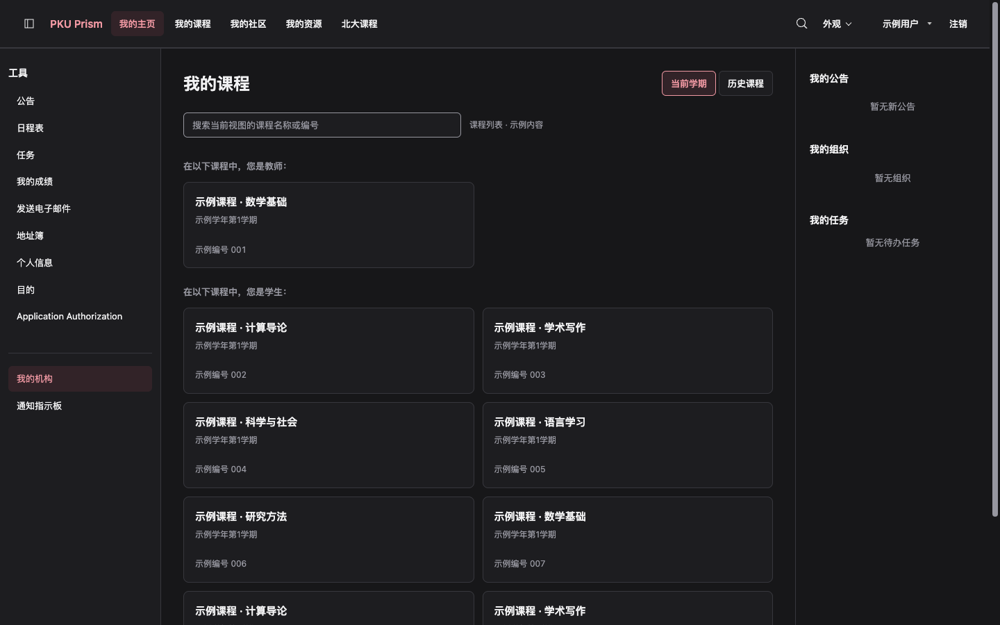
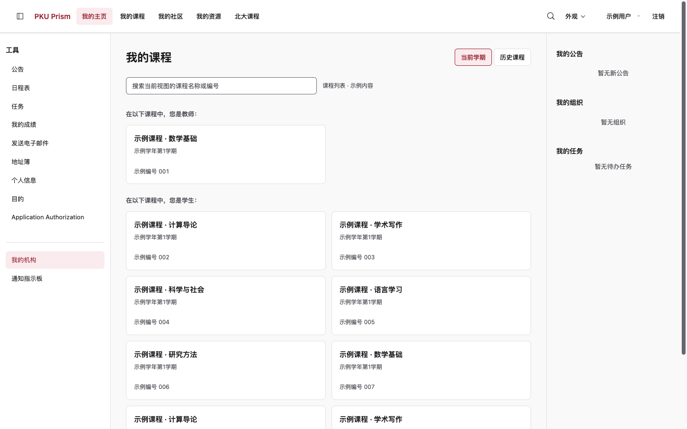

# PKU Prism

PKU Prism 是一个用于北京大学教学网的 Tampermonkey（油猴）脚本，重新整理导航、课程列表、公告和教学内容的布局，支持浅色、深色和跟随系统。

**[安装最新版](https://github.com/MiniYuanBot/pku-prism/releases/latest/download/pku-prism.user.js)** · [所有版本与更新说明](https://github.com/MiniYuanBot/pku-prism/releases)

安装链接在首个 Release 发布后生效。

打开教学网后，顶部是全站入口，左侧是当前页面的工具或课程目录。课程、作业和附件仍使用教学网原来的链接与控件；不习惯新界面时，可以在「外观」中随时停用。

## 界面预览

下面是在真实教学网页面截取的界面。账号、课程及公告内容已替换为示例，不包含个人学习记录。

查看浅色界面

## 功能

- **导航分成两层**：顶部保留「我的主页、我的课程、我的社区、我的资源、北大课程」，以及搜索、外观、账户和注销。左侧在主页显示工具，在课程内显示目录；课程名称、课程间切换和上级返回入口也放在侧栏，避免多条顶部导航堆叠。
- **课程更容易查找**：首页区分当前学期和历史课程，支持按名称或编号在当前视图中搜索，按角色分组显示课程卡片。课程名、学期和完整编号分别呈现，公告和事务在桌面右侧的辅助区。
- **公告有独立阅读区**：可以搜索公告目录、选择一条完整阅读，也能切回全部展开；窄屏下目录可以按需展开。
- **教学内容更紧凑**：资源与文件夹整理为列表，作业标题和附件保持可见，较长的说明按需展开。
- **浅深色一致**：导航、菜单、表格、表单和提示使用同一套主题。
- **侧栏可以完全收起**：宽屏默认展开，窄屏默认隐藏，通过顶部按钮打开抽屉。课程目录保留文字，不压缩成图标栏。
- **随时恢复原站**：停用后恢复教学网原来的界面，仍可随时重新启用。

任务、邮箱、通讯录、个人信息、目标、社区、资源库、日历、通知和成绩等页面也有基础适配。作业提交页、提交历史和总览保留原来的操作方式。

## 安装

从 Release 安装即可使用，无需配置开发环境。

### 第一步：准备 Tampermonkey

从 [Tampermonkey 官网](https://www.tampermonkey.net/) 安装对应浏览器的扩展，并允许它在 `course.pku.edu.cn` 上运行。Chrome / Edge 用户还需按扩展提示开启用户脚本权限；具体入口见 [Tampermonkey 官方说明](https://www.tampermonkey.net/faq.php#Q209)。

目前主要在 Chrome 中检查使用效果，其他浏览器尚未完成同等范围的测试。

### 第二步：安装 PKU Prism

1. 点击[安装最新版](https://github.com/MiniYuanBot/pku-prism/releases/latest/download/pku-prism.user.js)，或在 [Release 页面](https://github.com/MiniYuanBot/pku-prism/releases/latest)的 Assets 中选择 `pku-prism.user.js`。
2. Tampermonkey 打开安装页后，确认名称为 PKU Prism，点击「安装」。
3. 在 Tampermonkey 管理面板中确认 PKU Prism 已启用。

如果浏览器只下载了文件，可以在 Tampermonkey 管理面板的「实用工具 → 从 URL 安装」中粘贴[安装链接](https://github.com/MiniYuanBot/pku-prism/releases/latest/download/pku-prism.user.js)。也可以新建脚本，用下载文件的完整内容替换默认内容并保存。

### 第三步：打开教学网

登录[北大教学网](https://course.pku.edu.cn)并刷新页面。看到顶部 PKU Prism 标识和「外观」菜单后，即可切换主题或调整侧栏。

更新时再次打开安装链接，在 Tampermonkey 中确认更新，然后刷新教学网。自己构建脚本的步骤见[技术与开发说明](docs/DEVELOPMENT.md)。

## 使用

| 操作 | 位置与行为 |
| --- | --- |
| 切换浅色 / 深色 | 顶部「外观」→ 颜色模式；也可以选择「跟随系统」 |
| 暂时恢复原站 | 「外观」→「Prism 已启用」，点击后停用；控制入口仍可用于重新启用 |
| 完全关闭脚本 | 在 Tampermonkey 中关闭 PKU Prism，然后刷新页面 |
| 展开或收起侧栏 | 顶部左侧的侧栏按钮；窄屏抽屉可以按 Escape 关闭 |
| 查找课程 | 「我的课程」进入首页课程区，在当前学期或历史课程视图中搜索 |
| 阅读公告 | 选择目录中的公告，或使用全部展开；搜索只过滤当前列表 |

启停与颜色偏好会保存，并在教学网标签页之间同步。

### 与 Course Fetch 一起使用

[Course Fetch](https://github.com/MiniYuanBot/course-fetch) 用于整理和下载课堂实录。它与 Prism 是两个独立脚本，可以分别安装和停用。

Course Fetch 0.6.0 的面板已采用同一套样式：当前页面启用 Prism 时自动跟随浅深色；没有启用 Prism 时，可以在 Course Fetch 中单独选择「浅色 / 深色 / 跟随系统」。具体同步范围见[技术说明](docs/DEVELOPMENT.md#与-course-fetch-的主题同步)。

## 常见问题

### 安装后没有变化

确认 Tampermonkey 和脚本均已开启、扩展有运行权限，并刷新页面。Prism 在登录后的教学网页面运行，登录页和部分第三方页面会保持原样。

### 有些页面仍然像原站

首页、课程公告、教学内容和常见作业列表做了较多布局调整，其他页面主要统一导航和基础样式。部分课程定制、历史页面和第三方应用尚未适配，具体范围见[技术说明](docs/DEVELOPMENT.md#适配范围与限制)。

如果遇到错位或文字看不清，可以先停用 Prism，再反馈页面类型、操作步骤和截图。分享截图前请遮去姓名、学号、课程内容和成绩，不要附登录凭证或整页 HTML。

### 会不会影响作业提交或修改课程数据

Prism 只调整页面的显示和布局，保留教学网原来的操作方式，不会自动提交作业、修改成绩或发送邮件，也不读取登录凭证。

并非所有页面和操作都已完成测试。遇到异常时，可以先停用 Prism，再使用原站操作。测试范围见[验证记录](docs/verification.md)。

## 技术文档

界面参考 Linear、shadcn/ui 和 Notion，使用中性色与北大红 `#9E2533`。另外感谢 [PKU-Art](https://github.com/zhuozhiyongde/PKU-Art) 的灵感提供与实现参考！

源码构建、本地开发、Release 发布、实现方式和文件管理见[技术与开发说明](docs/DEVELOPMENT.md)。

[设计规范](docs/DESIGN.md) · [布局设计](docs/REDESIGN.md) · [页面研究](docs/research.md) · [验证记录](docs/verification.md)
